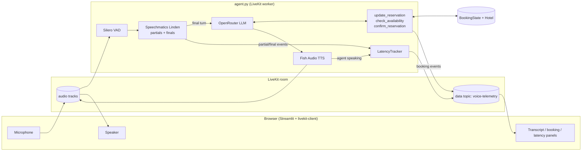

# Real-time hotel booking voice agent

A phone-style voice agent that takes hotel reservations in real time, and that shows the speech layer while the call is running: partial transcripts, final turns, and the delay between the final transcript and the agent's voice.

## Why

Voice agents often sound convincing until they have to capture a name, a date or a booking reference from a noisy call. One wrong token gets to the LLM, and the rest of the pipeline gives a polished answer to the wrong request. This project keeps that failure visible:

- **Partials and finals are streamed to the UI**, so you can see what the speech-to-text heard before it committed the turn.
- **The reservation is owned by code, not by the LLM.** The model proposes field updates through tool calls. `booking/state.py` validates them, applies them atomically and records corrections, so "make that the 18th, not the 16th" changes one field and nothing else.
- **Latency is split honestly** into two numbers:
  - *speech → final* includes the caller's own speaking time, so it is **not** a speech-to-text benchmark;
  - *final → voice* covers LLM generation and time to first TTS audio. This is the silence the caller notices after finishing a turn.

Speech-to-text, reasoning and speech generation stay swappable. LiveKit handles the room, media tracks, turn detection and provider routing.

## Stack

| Layer | Component |
| --- | --- |
| Real-time transport, turn handling | [LiveKit Agents](https://github.com/livekit/agents) |
| Speech-to-text | [Speechmatics](https://www.speechmatics.com/) Linden (`speechmatics/linden-1`) through LiveKit Inference |
| LLM | Any model on [OpenRouter](https://openrouter.ai/) (default `openai/gpt-4.1-mini`) |
| Text-to-speech | [Fish Audio](https://fish.audio/) (`fishaudio/s2-pro`) through LiveKit Inference |
| UI | [Streamlit](https://streamlit.io/) + [livekit-client](https://github.com/livekit/client-sdk-js) in the browser |

Speechmatics and Fish Audio run through **LiveKit Inference**, so there are no separate keys for them. Authentication, usage and billing go through your LiveKit project.

## Architecture



## Code map

```
hotel-booking-voice-agent/
├── agent.py              LiveKit worker entrypoint. Builds the AgentSession (VAD + STT + LLM + TTS),
│                         defines the BookingAgent and its three function tools, hooks session
│                         events into LatencyTracker and publishes telemetry to the browser.
├── app.py                Streamlit UI. Mints a LiveKit access token and embeds web/call.html.
├── web/call.html         Browser client: publishes the mic, plays agent audio, renders partial/final
│                         transcripts, live booking state and a per-turn latency table.
├── simulate.py           Offline replay of a scripted call (no keys, no audio) through the same
│                         state/inventory/latency code, including a mid-call date correction.
├── booking/
│   ├── state.py          BookingState: validated, atomic field updates, correction history,
│   │                     missing-field list and a speakable summary returned to the LLM.
│   ├── inventory.py      In-memory hotel: rates, capacity, availability per night, confirmation
│   │                     with a spoken-friendly reference code (no 0/O or 1/I).
│   ├── latency.py        LatencyTracker: speech_start / final / voice_start → per-turn
│   │                     speech→final and final→voice, plus median/p90 summary.
│   ├── prompts.py        System instructions: ≤3 sentences, ask only for missing fields,
│   │                     corrections win, confirm only on explicit yes.
│   └── telemetry.py      JSON wire format for the LiveKit data topic.
├── tests/test_booking.py Unit tests for state, corrections, inventory, latency and telemetry.
├── requirements.txt
└── .env.example
```

How the pieces fit: `agent.py` is the only file that talks to providers. Everything under `booking/` is plain Python with no network, so it is tested directly and replayed by `simulate.py`. The browser and the agent share only two things: the LiveKit audio tracks and JSON events on the `voice-telemetry` data topic.

## Run it

1. **Credentials.** Create a project in [LiveKit Cloud](https://cloud.livekit.io/). Under *Project Settings → Keys*, copy the WebSocket URL, API key and API secret. Get an [OpenRouter key](https://openrouter.ai/keys).

   ```bash
   cp .env.example .env   # then fill in LIVEKIT_URL, LIVEKIT_API_KEY, LIVEKIT_API_SECRET, OPENROUTER_API_KEY
   ```

2. **Install.**

   ```bash
   python -m venv .venv && source .venv/bin/activate
   pip install -r requirements.txt
   python agent.py download-files     # fetches the Silero VAD model once
   ```

3. **Start the agent worker** (terminal 1):

   ```bash
   python agent.py dev
   ```

4. **Start the UI** (terminal 2), open the page, toggle **Start call** and allow the microphone:

   ```bash
   streamlit run app.py
   ```

   Try: *"Hi, I'd like a deluxe room for two, October 16th to the 19th."* Then: *"Actually, make check-in the 18th."*

5. **No keys yet?** Run the offline pieces:

   ```bash
   python simulate.py     # scripted call with a correction, quote, confirmation and latency summary
   pytest -q
   ```

### Notes

- The latency panel measures the whole application, not just the STT provider. Speechmatics can return a final in roughly 250 ms once a turn end is signalled. Here LiveKit decides the turn boundary, and the app reports what the caller actually experiences.
- If your browser blocks the microphone inside Streamlit's component iframe, open the app on `localhost` (secure context) or allow microphone access for the page.
- `booking/inventory.py` is a stand-in. To book real rooms, replace it with your property-management system; the agent only calls `quote` and `confirm`.
- Swap models without code changes through `OPENROUTER_MODEL`, `STT_MODEL` and `TTS_MODEL`.
